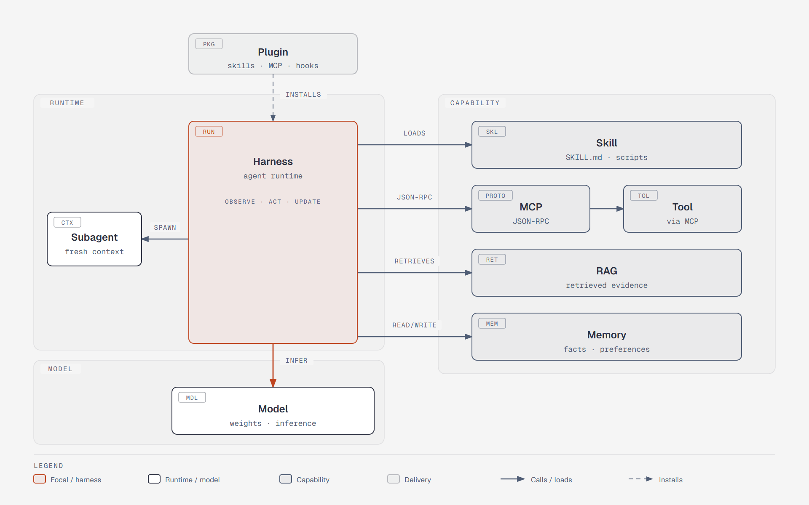
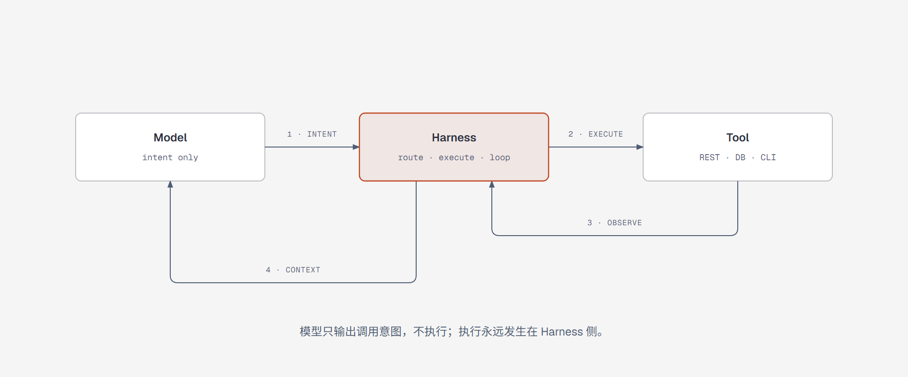
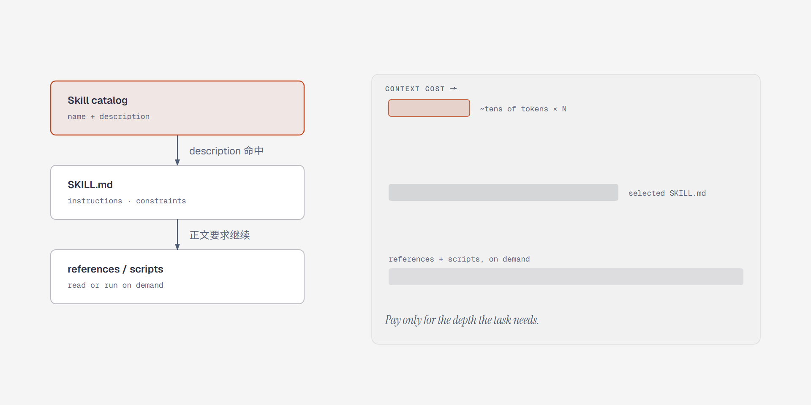
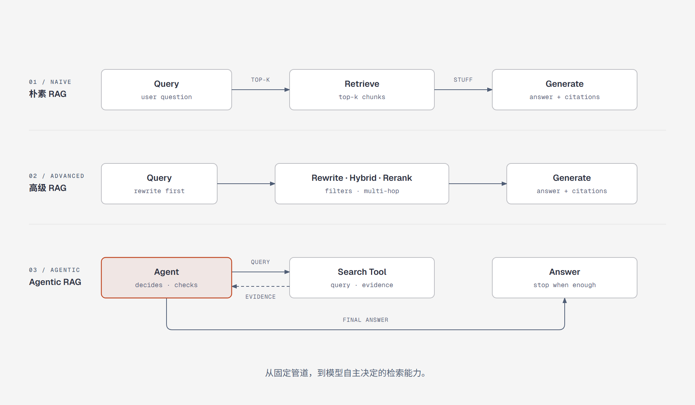
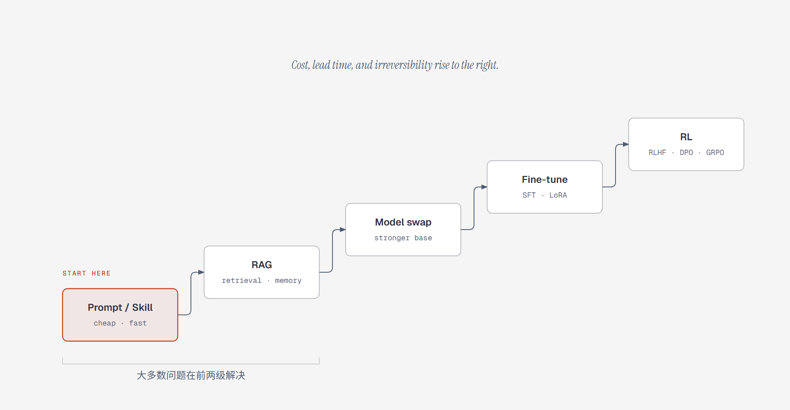
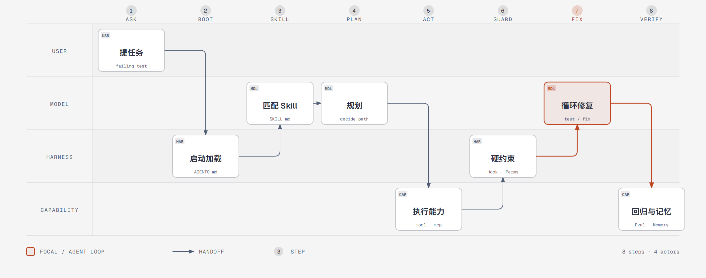
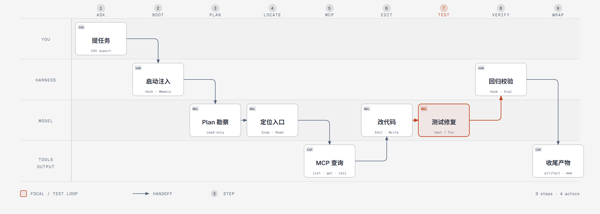

# 大模型领域概念全景：Skill、Harness、MCP 及周边

> 整理时间：2026-11 ｜ 面向：已经日常使用 ChatGPT / Claude / Qoder，但被一堆新名词绕晕的工程师
>
> 读法建议：先看第 0 节的图 1 和第 1 节建立坐标系，再按需查第 2 节词条；第 3 节的辨析表是全文最该记住的部分；第 5 节用 Qoder 当前环境做逐层对照。

---

## 0. 先用一句话把关系串起来

- **模型（Model）** 是大脑，本质上只会做一件事：根据已有上下文预测下一个 token。
- **Harness（运行框架/脚手架）** 是把大脑变成员工的整套装置：拼上下文、跑工具循环、管权限、开沙箱、记记忆、派子代理。
- **Tool（工具）** 是模型的手脚：一个带 JSON Schema 的可调用函数。
- **MCP** 是手脚的 **USB-C 接口标准**：让任意工具接进任意 harness。
- **Skill** 是 **岗位 SOP + 工具箱**：把“这类活该怎么干”连同脚本、模板、参考资料打包，按需加载。
- **Plugin** 是 **安装包**：把 skill、命令、子代理、hook、MCP 配置打成一个可分发单元。

一个 2026 年业界常见的说法：**Agent = Model + Harness**。模型越来越像 commodity，产品差异大半落在 harness 上。



> **图 1｜Harness 是唯一焦点。** 灰色大框是 Harness，它向下调用 Model（`INFER`），向左派生 Subagent（`SPAWN`），向右按需加载三类能力：Skill（**怎么干**）、RAG（**查资料**）、Memory（**记状态**）；MCP 作为标准通道把 Tool 接进来（`JSON-RPC`）。顶部 Plugin 以虚线 `INSTALLS` 把上述配置打包落地，虚线表示「安装期行为，不是运行时调用」。三个浅色分区分别是运行时、能力供给、模型。
>
> 可编辑源文件：[diagrams/llm-concept-map.html](diagrams/llm-concept-map.html)（内联 SVG，浏览器直接打开）

---

## 1. 坐标系：先把名词分到六层

```text
┌──────────────────────────────────────────────────────────────┐
│ ⑥ 交付层   Plugin · Command · Hook · 配置文件(AGENTS.md)      │
├──────────────────────────────────────────────────────────────┤
│ ⑤ 评测层   Benchmark · Eval Harness · pass@k · 回归集         │
├──────────────────────────────────────────────────────────────┤
│ ④ 运行时层 Harness · Agent Loop · Subagent · 权限 · 沙箱      │
├──────────────────────────────────────────────────────────────┤
│ ③ 能力供给 Skill · Tool · MCP · RAG · Memory · A2A            │
├──────────────────────────────────────────────────────────────┤
│ ② 上下文层 Prompt · Context Window · Context Engineering      │
├──────────────────────────────────────────────────────────────┤
│ ① 模型层   权重 · 推理 · 微调 · 量化 · 推理引擎               │
└──────────────────────────────────────────────────────────────┘
```

| 层 | 关注点 | 代表概念 | 一句话 |
|---|---|---|---|
| ① 模型层 | 改变或不改变权重 | 基座模型、SFT、LoRA、RLHF、DPO、量化、vLLM | 决定“智力上限”和“出厂习惯” |
| ② 上下文层 | 这一轮给模型看什么 | System Prompt、Context Window、Prompt Caching、Compaction | 决定“这一轮它知道什么” |
| ③ 能力供给 | 它能做什么、查什么、记住什么 | Tool、MCP、Skill、RAG、Memory、A2A | 决定“它的手脚和资料库” |
| ④ 运行时 | 谁在驱动、怎么循环、怎么兜底 | Harness、Agent Loop、Subagent、Permission、Sandbox | 决定“它能不能稳定把活干完” |
| ⑤ 评测 | 怎么证明它行 | SWE-bench、Terminal-Bench、pass@k、pass^k | 决定“你信不信它” |
| ⑥ 交付 | 怎么装、怎么触发、怎么约束 | Plugin、Command、Hook、AGENTS.md | 决定“怎么发给别人用” |

一层里出问题，别在另一层找答案。比如“模型总是不按格式输出”，可能不是模型笨，而是 harness 没做 structured output 约束；反过来“任务总做不完”，也可能不是 harness 烂，而是模型本身规划能力不够。

---

## 2. 核心概念逐个讲

### 2.1 Prompt / System Prompt / Context Window / Context Engineering

| 概念 | 定义 | 关键点 |
|---|---|---|
| **Prompt** | 单次请求里给模型的输入 | 一次性、易变、不沉淀 |
| **System Prompt** | 每次请求都置顶注入的角色与规则 | 产品行为的“宪法”，但会被长上下文稀释 |
| **Context Window** | 模型单次能看的 token 总量 | 2026 年主流已到 20 万~100 万级，但“能塞”≠“该塞” |
| **Context Engineering** | 系统性地决定哪些信息、以什么顺序、在什么时机进入上下文 | Prompt Engineering 的超集，2025 年中起成为主流说法 |

**Context Engineering 管的东西**：system prompt、工具定义、few-shot 示例、检索文档、记忆、历史消息、中间状态、草稿区。核心矛盾是 **信息量 vs 注意力**：塞得越多，模型越容易忽略关键指令（俗称 context rot / 上下文腐化），成本也越高。

常见手段：上下文压缩（compaction）、摘要、分层加载（渐进披露）、子代理隔离上下文、prompt caching、按需检索。

**常见误解**：以为“长上下文 = 不用 RAG”。实际上长上下文贵、慢、且中段信息利用率下降；长上下文和检索是互补关系。

---

### 2.2 Tool / Function Calling / Structured Output

**Tool（工具）**：一个带名字、描述、参数 JSON Schema 的函数，由 harness 注册给模型。模型不会真的执行它，只输出“我要调用 X，参数是 Y”，真正的执行在 harness 侧。

**Function Calling**：模型侧输出结构化调用意图的能力。它是**输出格式**，不是协议，也不是执行器。

**Structured Output**：约束模型输出符合给定 JSON Schema。实现方式有 prompt 约束、工具调用、受限解码（constrained decoding）。和 Function Calling 经常复用同一套机制，但目的不同：前者要“结果合规”，后者要“发起动作”。



> **图 2｜模型只输出意图。** ① 模型输出 `{name, arguments}`；② Harness 路由并执行；③ 结果作为 observation 回到 Harness；④ Harness 把结果回填上下文，循环直到停止条件。可编辑源文件：[flow-tool-call.html](diagrams/flow-tool-call.html)

**边界**：Tool 只描述“能做什么”，不描述“什么时候该做、按什么流程做”。后者属于 Skill / Prompt / Harness 的职责。

---

### 2.3 MCP（Model Context Protocol）

**一句话**：让 AI 应用连接外部工具与数据的开放协议，官方比喻是 “USB-C for AI”。

- 2024-11 由 Anthropic 发布，JSON-RPC 2.0，现已成为事实标准，OpenAI、Google、Microsoft 等均已支持。
- 拓扑：**Host**（Claude Desktop、IDE、Qoder 等）内嵌若干 **Client**，每个 Client 与一个 **Server** 一对一连接。
- 传输：本地 `stdio`；远程 **Streamable HTTP**（2025-03 规范起取代早期的 HTTP+SSE）。
- 解决了 **N×M 集成问题**：以前 M 个 AI 应用要分别对接 N 个工具；现在工具各写一个 MCP Server，应用各实现一个 Client，变成 N+M。

**服务端三大原语**：

| 原语 | 控制方 | 用途 | 例子 |
|---|---|---|---|
| **Tools** | 模型决定调用 | 可执行动作 | 查数据库、发请求、跑命令 |
| **Resources** | 应用决定读取 | 只读数据，URI 寻址 | 文件、日志、表结构 |
| **Prompts** | 用户主动选择 | 预置提示模板 | 斜杠命令背后的模板 |

**客户端侧原语**：Sampling（服务端反向请求宿主模型补全）、Roots（告知服务端可访问的目录边界）、Elicitation（服务端向用户追问）。

**MCP 不是什么**：

- 不是 Agent，它不跑循环、不做规划。
- 不是工具本身，它是工具的**接入协议**；一个 MCP Server 背后可以是任何 REST API、数据库、CLI。
- 不替代 REST，它是 REST/CLI 之上的一层统一发现与调用语义（含 OAuth 2.1 鉴权）。
- 不会自动解决“工具太多撑爆上下文”——工具 schema 全量注入仍是现实问题，业界在用工具检索、按需加载、代码执行等方式缓解。

---

### 2.4 Skill（Agent Skill）

**一句话**：把“某类任务的做事方法”打包成可按需加载的文件夹，通常包含一份 `SKILL.md` 和可选的脚本、模板、参考资料。

2025-10 由 Anthropic 提出并在 Claude 生态落地，随后 Qoder、Cursor 等工具跟进，逐渐成为跨平台的技能格式。

**目录形态**：

```text
my-skill/
├── SKILL.md            # YAML frontmatter(name, description) + 正文指令
├── scripts/            # 可选：可执行脚本
├── references/         # 可选：长文档、规范、示例
└── assets/             # 可选：模板、图片等
```

**核心机制：渐进披露（progressive disclosure）**



> **图 3｜只为当前需要的深度付费。** 启动时只注入 `name + description`（几十 token × N）；命中任务后才读 `SKILL.md`；正文要求继续时，才读 `references/` 或执行 `scripts/`。右侧条形是每一级真正进入上下文的成本。可编辑源文件：[flow-skill-disclosure.html](diagrams/flow-skill-disclosure.html)

这样既能让模型“知道有这门手艺”，又不为几十个 skill 付全量上下文成本。

**Skill 与 Prompt 的本质差别**：

| 维度 | Prompt 模板 | Skill |
|---|---|---|
| 形态 | 一段文本 | 目录：说明 + 脚本 + 资源 |
| 加载 | 每次全量 | 三级渐进披露 |
| 能力 | 只能“说” | 可以“做”（脚本在 harness 环境执行） |
| 复用 | 复制粘贴 | 版本化、可分发、可组合 |
| 触发 | 用户粘贴 | 模型按 description 自主匹配（也可被命令强制调用） |

**常见误解**：

- 以为 Skill 就是长提示词。错，Skill 的威力在于**可执行脚本 + 按需加载 + 版本化**。
- 以为 Skill 等于 Tool。Tool 是“一个动作”，Skill 是“一套流程，可能调用多个 Tool”。
- 以为 Skill 是模型能力。Skill 不改变权重，它是 harness 在运行时喂给模型的过程性知识。

---

### 2.5 Harness（运行框架 / 脚手架）

**一句话**：模型之外、让它能持续干活的全部工程。业界也直接叫 agent harness、agent runtime；早期论文里叫 scaffold（脚手架），SWE-agent 还提出过 ACI（Agent-Computer Interface，智能体-计算机接口）的说法。

**一个成熟 harness 通常包含**：

| 模块 | 作用 | 缺了会怎样 |
|---|---|---|
| System Prompt 组装 | 把角色、规则、环境信息拼成稳定前缀 | 行为漂移、规则被忽略 |
| 上下文管理 | 截断、压缩、摘要、缓存、分层加载 | 长任务中途“失忆” |
| 工具注册与执行 | 把工具 schema 给模型，路由并执行调用 | 模型只能空谈 |
| Agent Loop | 观察→思考→行动→再观察，含停止条件、最大轮数 | 死循环或半途而废 |
| 权限与审批 | 哪些操作要问人、哪些可自动 | 误删、误发、越权 |
| 沙箱 | 文件系统/网络/进程隔离 | 提示注入直接变事故 |
| Hook | 生命周期上的确定性回调 | 关键步骤没有硬保证 |
| 子代理 | 隔离上下文、并行、专业化 | 主线上下文被搜索结果淹没 |
| 记忆 | 跨会话的事实与偏好 | 每次从零开始 |
| 可观测性 | 日志、trace、token 统计、回放 | 出错无法定位 |
| 错误恢复 | 重试、降级、回滚 | 一次工具报错就中断 |

**为什么 harness 值得单独拎出来讲**：同一个模型，换一套 harness，benchmark 分数能差出十几个点。SWE-bench 上“裸模型 + function calling”和“专门设计的 agent 脚手架”完全不是一个量级，这也是 2025-2026 年“模型 + harness 联合报告成绩”成为惯例的原因。

**另一个同词不同义**：**Eval Harness（评测框架）**。在评测语境里，harness 指“跑基准的代码”：投喂任务、执行、判分、统计。和 agent harness 是两回事，但两者经常一起出现，因为 agent 成绩 = 模型 × agent harness × eval harness。

**Harness vs Framework**：

- **Framework**（LangGraph、AutoGen、CrewAI 等）是你**拿来搭**的库，控制权在开发者手里。
- **Harness** 是**已经搭好、开箱即用**的运行时，控制权在产品手里（Claude Code、Codex CLI、Qoder 都属于这一类）。
- 很多 harness 内部用 framework 实现，但对外暴露的是“模型 + 工具 + 权限”的成品体验。

---

### 2.6 Agent / Workflow / Copilot

| 概念 | 谁决定下一步 | 典型形态 | 适合场景 |
|---|---|---|---|
| **Chatbot** | 无步骤概念 | 一问一答 | 问答、写作 |
| **Copilot** | 人主导，模型补全 | 行内补全、侧边栏建议 | 编码辅助、文档润色 |
| **Workflow** | 代码/图结构决定 | 固定链路、DAG、状态机 | 步骤稳定、可审计 |
| **Agent** | 模型自己决定 | 观察-思考-行动循环 | 步骤不确定、需探索 |

Anthropic 在《Building effective agents》里的核心建议：**能用 workflow 就别上 agent**。workflow 可预测、便宜、好调试；agent 灵活但贵、慢、容易在复杂场景里“以复杂的方式失败”。

常见工作流模式：串行链、路由分发、并行投票、编排者-执行者（orchestrator-worker）、评估-优化循环。Agent 则是把这些模式在运行时动态组合。

---

### 2.7 Subagent / Multi-Agent / A2A

**Subagent（子代理）**：主代理派生出的独立执行单元，通常有自己的上下文窗口、工具集、甚至模型。价值在于：

- **上下文隔离**：让子代理去读 50 个文件，只回传 500 字结论，主线不被污染；
- **并行**：多个子任务同时跑；
- **专业化**：不同子代理配不同 prompt / 工具 / 权限；
- **权限最小化**：只读子代理拿不到写权限。

**Multi-Agent（多智能体）**：多个代理协作完成一个目标。要清醒：协调本身有成本，token 会成倍增长，错误会以组合方式放大。业界 2025 年有过一轮“别急着上多智能体”的反思，结论是**先压榨单代理 + 子代理，再考虑对等多智能体**。

**A2A（Agent2Agent）**：2025 年由 Google 提出、后捐给 Linux 基金会，解决**代理与代理之间**如何发现彼此、委派任务、交换结果（Agent Card 描述能力）。它和 MCP 是互补关系：

```text
MCP：Agent ↔ 工具/数据
A2A：Agent ↔ Agent
```

---

### 2.8 RAG / Memory / Knowledge Base

| 概念 | 存什么 | 何时用 | 典型实现 |
|---|---|---|---|
| **RAG** | 外部文档、知识库 | 每次请求按需检索证据 | 切块 + embedding + 向量检索 + 重排 |
| **Memory** | 跨会话的事实、偏好、经验 | 需要“记住用户/项目” | 记忆文件、记忆工具、向量库、结构化档案 |
| **Context** | 本轮窗口内的一切 | 永远 | 拼接 + 压缩 |

**RAG 的关键演进**：



> **图 4｜从固定管道到可控循环。** 朴素 RAG 一次检索后直接生成；高级 RAG 在检索前改写查询、混合召回并重排；Agentic RAG 把检索变成工具，由模型在循环里决定查什么、查几次、何时停。可编辑源文件：[flow-rag-evolution.html](diagrams/flow-rag-evolution.html)

**RAG vs 微调**：RAG 解决“知道”，微调解决“习惯”。要注入频繁变动的知识用 RAG；要改变输出风格、格式、领域语感用微调；两者可以叠加。

**Memory 的层次**：会话内（历史消息/草稿）→ 项目内（`AGENTS.md`、项目记忆）→ 用户级（跨项目偏好）→ 组织级（团队规范）。越往上越需要显式的读写策略与遗忘机制。

---

### 2.9 Plugin / Command / Hook / AGENTS.md

这四个都是 **harness 的扩展点**，但职责完全不同：

| 概念 | 本质 | 谁触发 | 确定性 |
|---|---|---|---|
| **Plugin** | 分发单元，打包 skill/命令/代理/hook/MCP | 安装后生效 | — |
| **Command** | 预置提示模板（如 `/security-scan`） | 用户显式调用 | 高（用户点了才跑） |
| **Hook** | 生命周期回调（shell 命令/脚本） | 事件自动触发 | **最高（不经过模型判断）** |
| **AGENTS.md** | 仓库级/用户级说明书，每次自动注入 | harness 启动时 | 高（但模型可能不听） |

关键区别：

- **Skill 是“模型自己判断要不要用”，Command 是“用户明确要求用”**。这是两者最容易被混淆的地方。
- **Hook 是唯一不依赖模型自觉的机制**。比如“改完 Python 必须跑格式化”“提交前必须跑测试”，写在 prompt 里模型可能忘，写成 hook 就是硬约束。
- **Plugin 不是能力，是包装**。一个 plugin 里可能什么都没有，只是一组 MCP 配置 + 两个命令。
- `AGENTS.md` 是开放约定（“给 agent 看的 README”），已被 Codex、Cursor、Qoder 等多类工具支持；通常支持用户级 → 项目级 → 子目录级的分层覆盖。

---

### 2.10 Permission / Sandbox / Guardrail

| 概念 | 防什么 | 机制 |
|---|---|---|
| **Permission（权限模式）** | 越权操作 | 询问 / 自动接受编辑 / 只读规划 / 全自动等档位 |
| **Sandbox（沙箱）** | 破坏范围 | 容器、gVisor、系统沙箱；限制文件、网络、进程 |
| **Guardrail（护栏）** | 内容与行为越界 | 输入输出分类器、策略过滤、敏感信息检测 |

三者不是一回事：权限管“要不要问人”，沙箱管“出事能坏到哪”，护栏管“内容合不合规”。对抗提示注入（prompt injection）时，**沙箱和权限是最后一道防线**，因为模型本身无法可靠区分“用户指令”和“网页里的恶意指令”。

---

### 2.11 Eval / Benchmark / pass@k

**Benchmark（基准）** 是考卷，**Eval Harness** 是考场 + 监考 + 判卷。

常见基准（各有侧重）：

| 基准 | 考什么 |
|---|---|
| MMLU / GPQA | 学科知识 |
| AIME / MATH | 数学推理 |
| SWE-bench / Verified | 真实仓库修 bug |
| Terminal-Bench | 终端里完成多步任务 |
| τ-bench | 工具调用 + 遵循业务规则 |
| GAIA | 通用助理任务 |
| OSWorld / WebArena | 操作真实系统/网页 |

**指标**：

- `pass@k`：采样 k 次，至少一次成功——衡量“上限”。
- `pass^k`：k 次全部成功——衡量“可靠性”。生产环境更该看这个。
- resolve rate：任务解决率。

**看榜三条纪律**：① 分数必须连 harness、提示、工具、预算一起看；② 警惕训练集污染与基准饱和；③ 公开榜和你的业务分布往往不是一回事，自建回归集比刷榜有用。

---

### 2.12 微调 / 对齐 / 蒸馏 / 量化

| 概念 | 改什么 | 解决什么 | 备注 |
|---|---|---|---|
| **SFT** | 权重 | 学会任务格式与领域表达 | 需要高质量示范数据 |
| **LoRA / QLoRA** | 少量适配器权重 | 低成本定制 | 消费级显卡也能跑 |
| **RLHF（PPO）** | 策略 | 对齐人类偏好 | 流程重，需奖励模型 |
| **DPO** | 策略 | 用偏好对直接优化 | 省掉显式奖励模型 |
| **GRPO** | 策略 | 组内相对优势，免 critic | DeepSeek 系带火 |
| **RLVR** | 策略 | 用可验证奖励（测试、答案）强化推理 | 数学/代码场景有效 |
| **Distillation** | 学生权重 | 把大模型能力压到小模型 | 降本提速 |
| **Quantization** | 数值精度 | INT4/FP8 等压缩显存 | 与训练无关，部署侧手段 |

**决策顺序**（成本从低到高）：



> **图 5｜先试便宜的。** 从左到右：改 prompt / 加 skill → 加 RAG → 换更强模型 → 微调 → 强化学习；成本、周期与不可逆性依次上升。绝大多数“模型不行”的问题，前两级就能解决。可编辑源文件：[flow-cost-ladder.html](diagrams/flow-cost-ladder.html)

**注意**：微调擅长“改变行为方式”，不擅长“记住最新事实”；后者的正确工具是 RAG 或工具调用。

---

### 2.13 推理模型 / Test-time Compute / CoT

- **CoT（思维链）**：让模型先写推理过程再给答案。
- **推理模型**：经过 RL 训练、会自主生成长思维链的模型（o 系列、R1 系列等），把“思考 token”当成一种可扩展的计算资源。
- **Test-time compute scaling**：推理阶段给更多思考预算，换取更高正确率。通常有 reasoning effort 档位。
- **Interleaved thinking**：思考与工具调用交替进行，边查边想。

代价：延迟与 token 成本显著上升，且简单任务上属于浪费。工程上要按任务难度路由，而不是全局开最高档。

---

### 2.14 上下文与推理基础设施

| 概念 | 作用 |
|---|---|
| **Prompt Caching** | 缓存稳定的前缀（system prompt、工具定义、长文档），大幅降本提速 |
| **KV Cache** | 推理引擎层缓存注意力键值，避免重复计算 |
| **Compaction** | 上下文将满时自动摘要/裁剪历史 |
| **Structured Output / Constrained Decoding** | 保证输出符合 schema |
| **推理引擎** | vLLM、SGLang、TensorRT-LLM 等，负责批处理、显存管理、吞吐优化 |
| **Tool Search / 动态工具加载** | 工具太多时，先检索再注入相关工具 schema |

---

### 2.15 Computer Use / Browser Use / Code Interpreter / Artifacts

| 概念 | 模型怎么“操作世界” |
|---|---|
| **Computer Use** | 看截图 → 输出鼠标键盘动作，操作整台桌面 |
| **Browser Use** | 通过浏览器自动化（DOM/可访问性树/截图）操作网页 |
| **Code Interpreter** | 在沙箱里写并执行代码，用代码代替手工计算与数据处理 |
| **Artifacts / Canvas** | 把长文档、网页、图表作为可迭代的独立产物渲染出来 |

趋势：**能用 API 就别用 UI**，能用代码就别用点击。Computer Use 是兜底手段，慢且脆；Browser Use 在有结构化接口时也优先走接口。

---

### 2.16 生态协议家族（补充）

| 协议/约定 | 连接谁和谁 | 状态 |
|---|---|---|
| **MCP** | Agent ↔ 工具/数据 | 事实标准 |
| **A2A** | Agent ↔ Agent | Linux 基金会托管 |
| **ACP**（Agent Client Protocol） | 编辑器/IDE ↔ 编码代理 | 编辑器生态推动 |
| **AG-UI** | Agent ↔ 前端界面 | 应用层协议，标准化程度较低 |
| **AGENTS.md** | 仓库 ↔ 任意代理 | 社区约定，非协议 |

记法：**MCP 管“手”，A2A 管“同事”，ACP 管“工位”，AG-UI 管“界面”**。

---

## 3. 关键辨析（最该记住的部分）

### 3.1 Skill / Tool / MCP / Plugin / Harness 一张表

| 维度 | Tool | Skill | MCP | Plugin | Harness |
|---|---|---|---|---|---|
| 本质 | 可调用函数 | 过程性知识包 | 接入协议 | 分发安装包 | 运行时 |
| 粒度 | 单个动作 | 一类任务的做法 | 连接层 | 一组能力 | 整个系统 |
| 是否可执行 | 是 | 可含可执行脚本 | 提供执行通道 | 否（打包） | 负责执行 |
| 谁决定使用 | 模型 | 模型（或命令强制） | 宿主连接 | 用户安装 | 系统调度 |
| 是否改模型 | 否 | 否 | 否 | 否 | 否 |
| 解决什么 | “能做什么” | “怎么做这类活” | “怎么接进来” | “怎么发出去” | “怎么稳定跑完” |
| 类比 | 手 | 岗位手册 + 工具箱 | USB-C | 应用安装包 | 整车 |

记忆口诀：**Tool 是手，Skill 是手艺，MCP 是插口，Plugin 是包装盒，Harness 是人和车间的总和。**

### 3.2 容易混的几组

**MCP vs Function Calling**
Function Calling 是模型“说要调什么”的输出格式；MCP 是宿主“怎么拿到工具、怎么执行”的协议。二者是上下游：宿主把 MCP 工具转成 function schema 喂给模型，模型输出调用意图，宿主再通过 MCP 执行。

**MCP vs REST API**
REST 是服务接口；MCP 是在其上加的统一发现、描述、调用、鉴权语义。一个 MCP Server 内部可以调十个 REST API。

**Skill vs Prompt**
Prompt 是这一轮说的话；Skill 是长期沉淀、按需加载、可带脚本的做事方法。

**Skill vs Subagent**
Subagent 是独立的执行上下文（自己的窗口和工具）；Skill 是知识包，可以给主线用，也可以预装进某个子代理。二者正交。

**Skill vs RAG**
Skill 是“精选过的流程与规范”，静态、可版本化；RAG 是“从大库里动态找证据”，覆盖广但质量参差。最佳实践常常是：Skill 里写“怎么查”，RAG 提供“查到什么”。

**Memory vs RAG vs Context**
Context 是本轮窗口；RAG 是按需检索外部知识；Memory 是跨会话保留的事实与偏好。三者都在“给模型信息”，但生命周期和写入方式不同。

**Agent vs Workflow**
Agent 自己决定下一步，Workflow 由代码决定下一步。前者灵活但不可预测，后者可预测但不灵活。

**Harness vs Framework**
Framework 是开发者搭东西的库；Harness 是开箱即用的成品运行时。

**Eval Harness vs Agent Harness**
前者是评测执行器，后者是产品运行时。看论文成绩时务必区分“模型分”和“模型 + 脚手架分”。

---

## 4. 一次真实请求里，它们如何协作

以“帮我修一下这个仓库里失败的测试”为例：



> **图 6｜协作发生在四条泳道之间。** 用户提出任务；Harness 注入 `AGENTS.md`、记忆与 skill 元数据；Model 匹配 skill、规划路径；能力层执行 Tool / MCP / Subagent；Harness 用 Hook 与权限兜住硬约束；Model 在测试失败后循环修复；最后做回归判定并写入记忆。步骤 7 是全图焦点：Agent Loop 的修复循环。可编辑源文件：[flow-request-lifecycle.html](diagrams/flow-request-lifecycle.html)

可以看到：**模型只负责判断和生成，其余每一环都由 harness 或协议兜住**。

---

## 5. 以 Qoder 当前环境为例

> 说明：Qoder 的能力清单会随版本、插件安装和账号权限变化。下面列的是**本会话中可见、可用**的实例，用来把抽象概念落到具体物上；你本地看到的可能略有出入，但分层关系不变。

### 5.1 概念 → Qoder 对应物

| 通用概念 | Qoder 里的实例 | 所属层 | 说明 |
|---|---|---|---|
| **Harness** | Qoder 客户端本身：Agent Loop、Plan 模式、Todo、权限档位、Hook、记忆、子代理调度 | ④ | 日常评价“Qoder 好不好用”，大半是在评价 harness |
| **Context Engineering** | 会话规则注入、自动记忆、SessionStart hook、上下文压缩、工作区检索路由 | ② | 同一模型在不同会话表现不同，多半是上下文不同 |
| **Tool** | Read / Edit / Write / Bash / Grep / Glob / WebFetch / WebSearch / ImageGen / VideoGen / present_visualization | ③ | 内置工具，随 harness 提供 |
| **MCP** | browser-use、github、node-repl、qoder-settings，以及插件自带的 server | ③ | 通过 `mcp_list` / `mcp_get` / `mcp_call` 按需发现与调用 |
| **Skill** | skill-creator、security-scan、imagegen、office-excel、office-docx、diagram-design、bailian-* 等 | ③ | `/` 可显式调用，模型也会按 description 自主匹配 |
| **Plugin** | `plugin:` 前缀的能力包：office-docx、office-excel、Presentations、sites、repowiki、collaboration-cli | ⑥ | 一个 plugin 可同时带 skill、MCP server、命令 |
| **Command** | `/security-scan`、`/skill-name` | ⑥ | Qoder 把命令入口与技能合并到 `/`，但触发语义仍分两种（见 5.3） |
| **Subagent** | Explore（只读定位）、Plan（只读规划）、general-purpose（多步执行）、自定义角色代理 | ④ | 独立上下文，只回传结论 |
| **Team / 多代理编排** | `create_team_task`、`send_message_to_chat_session`、`wait_chat_sessions` | ④ | 产品内的团队编排，不等同于跨厂商 A2A 协议 |
| **Memory** | 用户级与项目级 `MEMORY.md` + 单条记忆文件 | ③ | 索引 + 按需读取，与 Skill 的渐进披露同构 |
| **RAG / 知识检索** | SearchWorkspace（当前工作区语义检索）、SearchKnowledge（Repo Wiki / 知识卡）；QMind 等外部知识库视账号开通情况 | ③ | 三者检索对象不同：当前代码 / 已沉淀知识 / 外部库 |
| **Hook** | SessionStart hook 注入上下文（本会话开头就有一条）；可配置的其他生命周期钩子 | ④ / ⑥ | 确定性注入与约束，不靠模型自觉 |
| **Permission / HITL** | default / acceptEdits / plan / auto / dontAsk / yolo 等权限模式；计划审批、关键决策提问 | ④ | 决定“哪些动作必须问你” |
| **边界与隔离** | 工具受工作区范围与权限约束，高风险命令需确认 | ④ | 具体隔离强度取决于宿主配置，别默认有强沙箱 |
| **Artifacts / Canvas** | present_visualization、Canvas、Qoder Sites | ⑥ | 长文档、图表、站点作为可迭代产物 |
| **定时自动化** | `qoder_cron` | ⑥ | 把一次性流程变成周期性任务 |
| **Eval** | 项目自带测试、检查脚本、安全扫描 | ⑤ | Qoder 不替你定义业务正确性，回归闸门要自己建 |

### 5.2 同一个任务，在 Qoder 里怎么走

任务：**“给当前仓库加一个 CSV 导出接口，并保证不破坏已有测试。”**



> **图 7｜Qoder 侧的同一套分层。** ① 你提出任务；② SessionStart hook 与自动记忆注入上下文；③ Plan 子代理只读勘察，经 `ExitPlanMode` 审批；④ 主线 Grep/Read 定位入口；⑤ `mcp_list → mcp_get → mcp_call` 按需查询；⑥ Edit/Write 改代码；⑦ 跑测试、读日志、再改；⑧ Hook 与回归集做最终校验；⑨ 产物与记忆收尾。步骤 7 为焦点。可编辑源文件：[flow-qoder-task.html](diagrams/flow-qoder-task.html)

关键观察：**模型只出现在 [3][4][6][7] 的判断与生成里，其余每一环都由 harness、协议或你的配置兜住。** 这也解释了为什么“换个模型”往往不如“补一环 harness”见效快。

### 5.3 Qoder 侧最容易混的四组关系

**① Skill 与 Command：入口合并了，语义没合并**

Qoder 里两者都用 `/` 触发，区别不在斜杠，而在**谁发起**：

- `/security-scan`：你显式点名，属于命令式调用；
- 不输入斜杠时，模型根据 skill 的 `description` 自主匹配并读取 `SKILL.md`，属于技能式调用。

判断一个能力该做成哪种，看它是“我希望每次主动喊”还是“希望模型自己在该用的时候想起来”。

**② MCP 懒加载：正是“工具上下文膨胀”的工程解**

Qoder 没有把几十个 MCP server 的全部工具 schema 一次性塞进上下文，而是先暴露 `mcp_list` / `mcp_get` / `mcp_call` 三个元工具：先发现、再看 schema、最后调用。

- 收益：上下文可控，工具再多也不会把窗口撑爆；
- 代价：多一次发现调用，模型要学会“先找再用”。

这就是第 2.3 节提到的 **tool search / 按需加载** 的一个真实实现。

**③ Subagent ≠ Skill ≠ Team**

| 概念 | 在 Qoder 里是什么 | 解决什么 |
|---|---|---|
| Subagent（Explore / Plan / general-purpose） | 一个独立执行上下文：自己的窗口、工具、权限 | 隔离上下文、并行、专业化 |
| Skill | 一份知识包：说明 + 脚本 + 资源 | 告诉模型“这类活怎么做” |
| Team | 跨会话/跨成员的编排机制 | 把任务分给多个执行者并汇总 |

三者可以叠加：给子代理预装 skill，让团队成员各自再派子代理。但它们不是互相替代的关系。

**④ Memory 的 `MEMORY.md` 是索引，不是记忆本体**

`MEMORY.md` 只放一行式指针，真正的内容在单条记忆文件里，按需读取。这和 Skill 的渐进披露是同一个思路：**先用最小信息判断相关性，再付全量加载的成本。**

### 5.4 选型决策表：同一个需求该用哪种机制

| 你的需求 | 首选机制 | 理由 |
|---|---|---|
| 只是一次性要求 | 直接在对话里说（Prompt） | 零成本，不需要沉淀 |
| 一类活反复做，有固定步骤和脚本 | **Skill** | 可版本化、渐进加载、可执行 |
| 接公司内部系统、数据库、第三方 API | **MCP Server** | 一次接入，所有支持 MCP 的宿主复用 |
| 想把整套能力发给同事或团队 | **Plugin** | 打包 skill + MCP + 命令 + hook |
| 要隔离上下文或并行调研 | **Subagent** | 避免主线被搜索结果淹没 |
| 必须每次执行、不能靠模型自觉 | **Hook** | 确定性回调，绕开模型判断 |
| 要跨会话记住偏好或项目事实 | **Memory** | 持久化，按需注入 |
| 要查最新文档或沉淀知识 | **RAG / 知识卡** | 动态检索，避免用微调注入知识 |
| 要改变输出风格、格式或领域语感 | **微调（SFT / LoRA）** | 改变行为，不是加知识 |
| 要跑长周期自动化 | **qoder_cron** | 定时触发，不依赖你在场 |
| 高风险动作必须由人拍板 | **权限档位 + 计划审批** | Human-in-the-loop |

一句话：**先问“这是知识、能力、通道、约束还是编排”，再决定用哪一层。**

### 5.5 在 Qoder 里验证这些概念的最小实验

1. **验证 Skill 的渐进披露**：输入 `/security-scan`，观察它是否先读 `SKILL.md` 再按需读 references，而不是一上来全量加载。
2. **验证 MCP 懒加载**：让它查一个 GitHub PR，观察调用链是否先 `mcp_list` 再 `mcp_get` 再 `mcp_call`。
3. **验证子代理隔离**：让 Explore 在大型目录里搜索，比较主线上下文是否只多了结论、没有多出几十个文件内容。
4. **验证 Hook 的确定性**：配置一个 SessionStart hook 注入一行项目约定，重开会话看是否每次都生效。
5. **验证 Memory 的索引结构**：明确要求记住一条事实，检查 `MEMORY.md` 是否只增加了一行指针、正文是否落在独立文件里。

做完这五个实验，第 1 节的六层坐标系就不再是抽象图，而是你能在界面上指出来的东西。

---

## 6. 十个常见误区

1. **“MCP 就是插件/工具”** —— MCP 是协议，工具是能力，插件是包装。
2. **“Skill 就是长提示词”** —— Skill 有目录结构、渐进加载、可执行脚本，是工程资产。
3. **“模型够强就不需要 harness”** —— 产品体验的差异大半来自 harness；同一模型换脚手架成绩能差很多。
4. **“Agent 一定比 Workflow 好”** —— 步骤稳定时 workflow 更便宜、更可靠、更好审计。
5. **“多智能体一定更强”** —— 协调成本、token 成本、失败模式都会放大，先压榨单代理。
6. **“微调可以注入最新知识”** —— 不可靠，且更新成本高；知识用 RAG，行为用微调。
7. **“上下文越长越好”** —— 长上下文贵、慢、中段信息利用率下降，还要防 context rot。
8. **“RAG 已经过时”** —— 它变成了 agentic RAG / 检索工具，反而更常见。
9. **“榜单分数可以直接横比”** —— 必须对齐模型版本、harness、提示、工具与预算。
10. **“Prompt Engineering 死了”** —— 它升级成了 Context Engineering，核心仍是“把对的信息在对的时机给模型”。

---

## 7. 术语速查表

| 英文 | 中文常用叫法 | 一句话 | 层 |
|---|---|---|---|
| Model | 模型 / 基座 | 预测下一个 token 的权重 | ① |
| Prompt | 提示词 | 本轮输入 | ② |
| System Prompt | 系统提示 | 常驻角色与规则 | ② |
| Context Window | 上下文窗口 | 单次可见 token 上限 | ② |
| Context Engineering | 上下文工程 | 系统性地决定给模型看什么 | ② |
| Tool | 工具 | 可调用函数 | ③ |
| Function Calling | 函数调用 | 模型输出调用意图的格式 | ③ |
| MCP | 模型上下文协议 | 工具接入的 USB-C | ③ |
| Skill | 技能 | 可按需加载的做事方法包 | ③ |
| RAG | 检索增强生成 | 先查资料再回答 | ③ |
| Memory | 记忆 | 跨会话保留的事实与偏好 | ③ |
| A2A | 代理间协议 | 代理与代理协作 | ③ |
| Harness | 运行框架 / 脚手架 | 让模型持续干活的整套工程 | ④ |
| Agent Loop | 智能体循环 | 观察-思考-行动 | ④ |
| Subagent | 子代理 | 隔离上下文的执行单元 | ④ |
| Sandbox | 沙箱 | 限制破坏范围 | ④ |
| Guardrail | 护栏 | 内容与行为合规过滤 | ④ |
| Plugin | 插件 | 能力打包分发单元 | ⑥ |
| Command | 命令 | 用户显式触发的模板 | ⑥ |
| Hook | 钩子 | 生命周期上的确定性回调 | ⑥ |
| Benchmark | 基准测试 | 考卷 | ⑤ |
| Eval Harness | 评测框架 | 考场 + 判卷 | ⑤ |
| pass@k / pass^k | — | 上限 / 可靠性 | ⑤ |
| SFT / LoRA | 监督微调 / 低秩适配 | 改行为与风格 | ① |
| RLHF / DPO / GRPO | 人类反馈强化 / 直接偏好优化 / 组相对策略优化 | 对齐偏好 | ① |
| Distillation | 蒸馏 | 大模型教小模型 | ① |
| Quantization | 量化 | 降精度省显存 | ① |
| Test-time Compute | 测试时计算 | 多想一会儿换正确率 | ② |

---

## 8. 演进时间线（只列改变范式的节点）

| 时间 | 事件 | 留下的概念 |
|---|---|---|
| 2022-11 | ChatGPT 发布 | RLHF、对话式交互 |
| 2023 | Function Calling、RAG 普及、DPO 提出 | 工具调用、检索增强、偏好优化 |
| 2024-09 | o1 发布 | 推理模型、test-time compute |
| 2024-11 | **MCP 发布** | 工具接入标准化 |
| 2024-12 | Agentic 编码代理兴起（SWE-bench 范式） | Harness / Scaffold / ACI |
| 2025-01 | R1 开源 | 推理能力平民化、GRPO |
| 2025 年中 | **Context Engineering** 成为主流表述 | 上下文管理、compaction |
| 2025-04 | A2A 提出 | 代理间协作协议 |
| 2025-08 起 | `AGENTS.md` 约定扩散 | 仓库级代理说明书 |
| 2025-10 | **Agent Skills 发布** | 渐进披露、技能生态 |
| 2025-2026 | Terminal-Bench 等“长任务”基准流行 | 评测从“答题”转向“干活” |
| 2026 | “Agent = Model + Harness”成为共识 | harness 工程化、技能/插件生态、长期记忆 |

---

## 9. 延伸阅读

- Anthropic, *Building Effective Agents*：<https://www.anthropic.com/engineering/building-effective-agents>
- Anthropic, *Effective Context Engineering for AI Agents*：<https://www.anthropic.com/engineering/effective-context-engineering-for-ai-agents>
- MCP 官方文档与规范：<https://modelcontextprotocol.io>
- Agent Skills 文档：<https://docs.claude.com/en/docs/agents-and-tools/agent-skills/overview>
- A2A 协议：<https://a2a-protocol.org>
- AGENTS.md 约定：<https://agents.md>

---

## 附：三句话总结

1. **模型决定上限，harness 决定兑现率。**
2. **Tool 给能力，Skill 给方法，MCP 给通道，Plugin 给分发。**
3. **能用 workflow 别上 agent，能用单代理别上多代理，能改上下文别改权重。**
